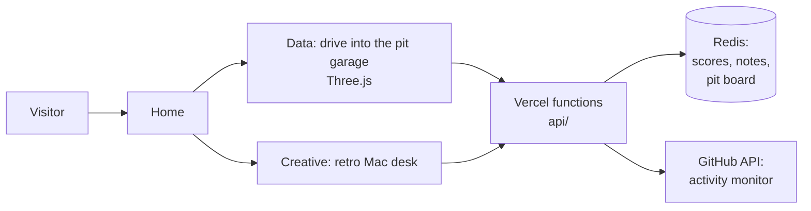

# krish viramgama: data scientist / creative

**My portfolio, where the interaction *is* the navigation.** Live at **[krishviramgama.vercel.app](https://krishviramgama.vercel.app)**.

One person, two alter egos, and you pick which one to meet: drive an F1 car into a pit garage to see the data side, or sit at a retro Mac to see the creative side.


---

## Who it's for

| You are… | What to do on the site |
|---|---|
| 🧑‍💼 **A recruiter with two minutes** | Press **Q** on either page for the *quick lap*: the 60-second version. In the garage, the printer hands you my CV. |
| 🏷️ **A brand looking for a creative partner** | Go to the creative side for the work, the content and **Koach**, the creative studio I co-founded. |
| 👩‍💻 **A developer who's curious** | Everything is hand-built with no framework. The interesting parts are listed under [Under the hood](#under-the-hood). |
| 🙋 **Just browsing** | Drive the car, play the Mac games, leave a sticky note or sign the pit board. Other visitors will see it. |

---

## The two alter egos

<table>
<tr>
<td width="50%"></td>
<td width="50%"></td>
</tr>
<tr>
<td valign="top">

**Data** (`/data/`): you drive an F1 car into the pit box, and the steering wheel *is* the page. Its modes show the projects, your own lap read back as telemetry, team radio, and **LAB**, where a tiny neural network written from scratch learns to brake from your drive. Then you get out and walk the garage: the pit wall, an engineers' stand where you hear a speech-enhancement model clean a radio call, a printer for the CV, a pit-board guestbook and a monitor with my GitHub activity.

</td>
<td valign="top">

**Creative** (`/creative/`): a desk with a working retro Mac, with floppy disks, games with a shared leaderboard and sticky notes visitors leave for each other. Then the work, the content and Koach.

</td>
</tr>
</table>

---

## Under the hood

- **A 3D garage in the browser.** Three.js scene with a drivable car, a walkable garage and stations you can use. The car is a CC BY concept model, converted, simplified and repainted by [`scripts/concept-to-glb.mjs`](scripts/concept-to-glb.mjs).
- **A neural network with no library.** LAB trains a small network from scratch, in the browser, on the lap you just drove.
- **Shared, live state.** Vercel functions with Redis power the game leaderboard, the sticky notes, the pit-board guestbook and the GitHub activity monitor ([`api/`](api/)).
- **Escapes in-app browsers.** Open the site from Instagram, TikTok or Facebook and it hands you to Safari or Chrome, where everything works (an idea from my [unlock](https://github.com/figureitoutwithkrish/unlock) project).
- **Works on phones.** Steer buttons and a swipe-proof cockpit for the drive, and a joystick to walk the garage.
- **Respects your settings.** Reduced-motion users get still frames instead of animation, and the content stays readable without JavaScript.



## Stack

Vanilla JS on **Vite** (multi-page), **Three.js** for the garage, **GSAP** and **Lenis** for motion, and **Vercel** functions with **Redis** for the shared bits. No framework: every interaction is hand-built.

```bash
npm install
npm run dev       # dev server
npm run build     # production build -> dist/
npm run preview   # serve the production build
```

How it's put together: [`design-system/`](design-system/) (the design rules, page by page) and [`docs-backend.md`](docs-backend.md) (the functions and the database).

## Credits

- The car: ["F1 2026 concept (polygon model)"](https://sketchfab.com/3d-models/f1-2026-concept-polygon-model-ea3bde709b1e4dc9b0ec8557d106ed42) by [Qvist_designs](https://sketchfab.com/Qvist_Designs), [CC BY 4.0](https://creativecommons.org/licenses/by/4.0/). Converted, simplified and repainted by `scripts/concept-to-glb.mjs` and `src/three/garage/car-livery.js`.
- Radio check clips: speech from LibriSpeech and gunfire from Kabealo & Wyatt's dataset, both CC BY 4.0.
- Nohemi typeface by Rajesh Rajput ([Gumroad](https://rajputrajesh-448.gumroad.com/l/NOHEMI9)), used under its own terms, not this repo's licence.

## Licence

The code is here to read and learn from. My photos, artwork, client work, music, copy and personal content are **all rights reserved**: please don't reuse them. See [`LICENSE`](LICENSE).
